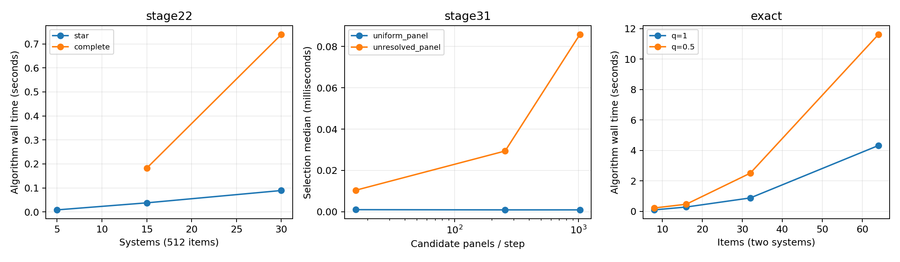
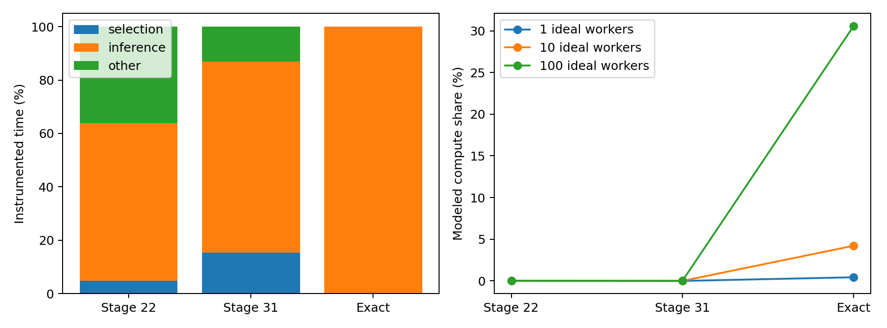

# Computational efficiency of SAFE-EVAL adaptive evaluation

Branch: `research/computational-efficiency-profile`, based on remote main
`ecdd7e6cf3f2ef54355f2a7b8eb503ec76bbd83d`. This study adds profiling artifacts
only. Existing implementations, main and previous experiments are preserved.

**Decision: NO-GO for generic faster selection as the main research direction.
Conditional GO for the computational feasibility of exact sequential inference,
especially larger pools or many independent concurrent evaluations.** The tested
Stage 22/31 policies are already far faster than human annotation. Exact inference
is measurably slower, but a faster implementation alone is not yet an ICML claim.

All 120 measurements finished without errors/timeouts. All 120 plain/instrumented
output checks and all 40 repeated-output checks passed. Nine Stage 31 workload
configurations (27 repetitions) hit their available-round cap; these are not
reported as successful stopping. No wrong decisions occurred on these fixed
fixtures, which is not evidence establishing 95% coverage.

## Measured results

Windows 11, Intel Family 6 Model 186, 12 logical/10 physical CPUs; Python 3.12.4,
NumPy 2.2.4, SciPy 1.16.3; one BLAS/OpenMP thread. Values below are repetition
medians. Stage 22 uses 15 systems, 512 items, 105 requested pairs and separated
scores. Stage 31 uses 15 systems, 16 candidates, 6,000 available rounds and the
original 70% target. Exact examples use two binary systems, strong aligned priors,
and q=.5. These are different tasks, not a matched accuracy comparison.

| Method | Selection p50 / p95 (microseconds) | Algorithm wall (s) | CPU (s) | CPU/core (%) | Peak process MiB | Steps |
|---|---:|---:|---:|---:|---:|---:|
| Stage 22 common | 0.5 / 12.1 | 0.196 | 0.0625 | 32.0 | 38.1 | 3,073 cells |
| Stage 22 pruning | 0.5 / 24.3 | 0.182 | 0.0625 | 33.6 | 38.1 | 2,901 cells |
| Stage 31 uniform | 0.8 / 1.6 | 0.105 | 0.0156 | 12.3 | 36.6 | 1,573 panels |
| Stage 31 unresolved | 10.5 / 18.2 | 0.100 | 0.0625 | 58.7 | 36.7 | 1,057 panels |
| Exact, 32 items | 87.6 / 130.2 | 2.510 | 1.2500 | 49.8 | 70.1 | 13 steps / 19 cells |
| Exact, 64 items | 91.7 / 152.8 | 11.612 | 4.2344 | 37.8 | 70.4 | 16 steps / 24 cells |

Algorithm wall excludes preprocessing: Stage 22 pruning adds 0.115 s full-path
inference; Stage 31 unresolved adds 0.013 s panel enumeration in these examples.
CPU/core is process CPU divided by wall, with one core=100%; values are medians
of per-run ratios, not ratios of medians. Windows CPU time is coarse: several
very short cases report zero CPU seconds despite doing work. Do not interpret
that as zero computation. The system CPU snapshot was 6.6%; the machine was not
isolated, so these numbers do not prove hardware saturation or its absence at
other scales. Maximum measured peak working set was 110.3 MiB (30-system panels).

A separately labeled warmed-process supplement measures Stage 22 offline CPU
for the eight fixtures, three repetitions each. For the representative complete
15-system fixture it averages 0.100 s wall and 0.0208 s CPU; for the 30-system
complete fixture, 0.219 s wall and 0.0208 s CPU. These coarse CPU-clock readings
are not precise scaling evidence and are not added to fresh-process medians.
All 24 supplement output hashes reproduce within fixture. See
`results/preprocessing_cpu.json` for the individual values.

Pooled instrumented phase fractions:

| Representative method | Selection | Inference | Other |
|---|---:|---:|---:|
| Stage 22 pruning | 4.9% | 58.9% | 36.2% |
| Stage 31 unresolved | 15.4% | 71.5% | 13.1% |
| Exact, 32 items | 0.050% | 99.888% | 0.063% |

For exact 32 items, inference p95 is 0.232 s/step; for 64 items, 0.818 s/step.
The separate cProfile run (same result digest) spent 2.008/2.732 s = **73.5%**
inside worst_null (193 calls), and 0.663 s = **24.3%** inside minimize (141 calls).
These two cumulative entries do not nest in one another; factor's cumulative
time does contain both and must not be added to them. The dominant bottleneck
is statistical factor certification, particularly its dynamic-program separation
oracle. Choosing an item is negligible.

Instrumentation/plain median ratios range from 0.78 to 1.42 across configurations.
They include cache/order/scheduling effects and are not pure overhead estimates.
Sub-microsecond selection measurements are near the timer/instrumentation scale;
the conclusion relies on their being negligible next to human seconds, not on
precise comparisons among 0.5 and 0.8 microseconds.

Selected scaling measurements (all medians):

| Workload change | Observed effect |
|---|---|
| Stage 22 pruned star, S=15, N=128/512/2048 | replay 0.029/0.038/0.043 s; offline inference 0.018/0.094/0.311 s; 552/715/838 acquired cells |
| Stage 22 pruned, S=15, N=512, star to complete | pairs 14 to 105; replay 0.038 to 0.182 s; 715 to 2,901 cells |
| Stage 22 pruned complete, S=15 to 30, N=512 | pairs 105 to 435; replay 0.182 to 0.739 s; peak 38.1 to 44.8 MiB; 2,901 to 10,518 cells |
| Stage 22 pruned complete, S=15,N=512, exact ties | all 7,680 cells required; replay 0.674 s, offline 0.109 s |
| Stage 31 unresolved, S=15, candidates 16/256/1024 | selection p50 10.4/29.4/85.8 microseconds; p95 19.4/47.9/138.0 microseconds |
| Stage 31 panel enumeration, S=15 to 30 | 3,003 to 142,506 panels; setup 0.013 to 0.843 s; peak 35.5 to 110.2 MiB (1,024-round fixture) |
| Stage 31 unresolved, 256/1024/6000 available rounds | 256/1024/1057 executed; wall 0.025/0.082/0.100 s; first two capped, last reaches target |
| Exact q=1, N=8/16/32/64 | wall 0.098/0.285/0.883/4.323 s; executed steps 5/6/5/7 |
| Exact q=.5, N=8/16/32/64 | wall 0.223/0.469/2.510/11.612 s; executed steps 6/6/13/16 |
| Exact q=.5, N=32, strong/moderate/adverse | wall 2.510/3.765/2.489 s; 13/23/12 steps |

For the candidate-count row, S=15 and the round cap is 1,024; executed rounds
are 1,024/1,006/1,024, with only the middle case reaching the target. Fixtures
across sizes/counts are deterministic but not identical trajectories. Stopping
and signal geometry confound total-runtime slopes; per-step and setup metrics
help distinguish these effects. No complexity exponent is fitted from 3 points.

## Practical significance and recommendation

At 30 seconds/cell, serial computation (including the separately timed setup)
is **0.00034%** of modeled Stage 22 pruning time, **0.438%** for exact 32 items,
and **1.587%** for exact 64 items. At 104 seconds/panel, Stage 31 unresolved is
**0.00010%**. Even completely eliminating computation gives only these percentage
reductions in the respective serial totals.

For the optimistic 100-worker aggregate model at those latencies, compute shares
are 0.034% / 0.010% for Stage 22 / Stage 31, versus 30.6% / 61.7% for exact
32 / 64 items. At 10 ideal workers, exact 64 items is 13.9%. These scenarios
show potential throughput relevance for many independent exact tasks, not a
valid way to parallelize one adaptive path. Across the full sensitivity matrix,
Stage 22 and Stage 31 remain below 0.55% and 0.30% respectively, even at the
fastest assumed annotation latency with 100 ideal workers. Exact 64 items reaches
4.62% serial compute share at the fast 10-second/cell assumption.

**NO-GO:** making generic Stage 22/31 selection faster is not supported as a
meaningful standalone research contribution for human-in-the-loop evaluation at
the tested scales. The main practical resource remains human annotation, and
Stage 31's large panel enumeration is currently an initialization/engineering
issue rather than evidence of a valuable new statistical algorithm.

**Conditional GO:** pursue a narrowly scoped computational-feasibility question
for exact conditional factor certification if exact inference remains scientifically
valuable. Pool scaling already yields visible per-step delay, with 99.9% of
runtime in inference. A future contribution would need a rigorous complexity or
certification advance preserving the same valid factors, plus evidence at useful
pool sizes and against strong exact baselines. No optimization has been designed
or evaluated here, and current timings alone are insufficient for an ICML claim.

The most useful next step is to measure actual annotation/UI latency and intended
concurrency in the existing human pilot, then set a concrete inference latency
budget. Prioritize annotation efficiency/experimental validity for fast policies;
only prioritize exact-computation research if the exact method and deployment
requirements justify it. Do not extrapolate these two-system results to a general
multi-system exact solver or claim unmeasured WMT performance.

## Scope and interpretation

The frozen [protocol](PROTOCOL.md) covers Stage 22 common/pruned graph replay,
Stage 31 uniform/unresolved panel selection, and exact sequential conditional
inference. Forty workload configurations each receive three fresh-process timing
repetitions. Synthetic data and acquisition seed are fixed at 731. Original
95% thresholds, solver settings and stopping rules remain in place. This is a
computational study, not a new coverage experiment or a comparison of statistical
power across different tasks. No WMT dataset is read and no optimization is added.

Wall time and process CPU time come from the original function. A separate
instrumented pass times disjoint statement blocks and must reproduce its full
output digest. Phase fractions and per-step quantiles are diagnostic, affected by
timer overhead, warm caches and scheduling. Medians use all three repetitions;
observed ranges are in the CSV. One fixed fixture per configuration limits
generalization to other score distributions and stopping trajectories.

Stage 22 evidence is precomputed for a complete path before acquisition replay.
We report that cost separately; replay's close_free lookup is not the cost of a
live CS update. This existing offline implementation accesses future synthetic
scores for simulation and cannot be treated as a deployable online procedure.
Stage 31's available-round cap is distinguished from achieving its 70% pair
certification target. Exact sequential is only a two-system binary prototype.
Numbers across the three algorithms are not matched-task speed comparisons.

## Scalability and structural bottlenecks

Stage 22's full-path inference stores pair-by-item arrays and performs vectorized
updates for each item. Its storage/work therefore grows with requested pairs
times items (six betting components per direction). Complete graphs have
S(S-1)/2 edges; reference stars have S-1. Changing the graph also changes the
family-wise threshold and the trajectory length. Wall-time differences are not
pure estimates of an asymptotic exponent. Increasing available items can leave
the acquisition cost nearly unchanged when the strong-signal path stops early,
while still increasing offline preprocessing.

Stage 31 enumerates all C(S,5) five-way panels and their ten pair indices at
initialization. This is a combinatorial setup/storage issue. Actual adaptive
selection scores only C supplied candidate panels per round, with ten edge
lookups each: its selection work scales with C, not with all C(S,5) panels.
Per-round stopping checks scan pair state; final rank closure has cubic system
dimension in the existing implementation. Do not conflate setup enumeration with
candidate selection. Very large system counts are not benchmarked or extrapolated
as measured performance.

Exact sequential constructs two Designs and solves two cutting-plane factor
problems before acquiring each next label batch. The separation oracle
`Design.worst_null` uses a dynamic program with item-by-sum state arrays of
quadratic size in pool length. Each cutting-plane round also invokes SLSQP, with
up to 80 rounds and 500 solver iterations per round. This creates a fundamentally
different computational regime from selecting among a short candidate list.
Fixed seeds and source inspection support a structural explanation; the timing
matrix does not establish a worst-case runtime theorem.

## Human annotation latency model

[WMT17 findings, Table 9](https://www.statmt.org/wmt17/pdf/WMT17.pdf) reports
17.1/17.5 seconds per DA translation and 20.8 seconds per translation for the
five-translation RR task (104 seconds per panel). These are historical,
idle-filtered, task-dependent averages; the paper cautions that comparisons are
approximate. They are anchors rather than measurements of SAFE-EVAL users.

The full sensitivity table uses 10/30/60 seconds per cell and 30/104/180 seconds
per panel, with 1/10/100 ideal workers. Computation is plain algorithm wall plus
Stage 22 full-path inference or Stage 31 panel setup, excluding interpreter and
fixture startup. Modeled time is computation + queries * latency / workers.
The hypothetical maximum benefit of free computation is the compute fraction of
that sum. No annotation or network/UI measurement is fabricated.

The multi-worker model assumes perfect load balancing and treats computation as
serialized. It is an optimistic aggregate-work bound, not a feasible schedule for
one strictly adaptive trajectory. Decisions depend on previous labels; batching
future queries could change acquisition rules and needs a separate validity
analysis. Simultaneous annotators do not automatically make selection latency
the limiting factor.

## Limitations and research decision criteria

This machine is not an isolated benchmark server. CPU-clock quantization and
scheduling/frequency variation affect short runs. Process peak working set
includes interpreter, imports, fixtures and transient setup allocations; it is
not algorithm-only memory. Representative timings and raw ranges should guide
interpretation rather than tiny speed differences between repetitions. Hardware
and package versions, source hashes and machine snapshot accompany results.

No claim is made about predictor training, data ingestion, web serving, network
latency, real human throughput, WMT-scale exact inference, or multi-system exact
inference. The timeout rule and tested scale limits are stated in the protocol. No change
to a statistical guarantee follows from output parity or a profiler run.

A worthwhile computational contribution would need to preserve the same
certificate and acquisition semantics, demonstrate a meaningful limiting regime,
and outperform strong exact computational baselines. Profiling alone establishes
neither algorithmic novelty nor ICML-level significance. The next decision should
separate engineering feasibility for exact inference from annotation-efficiency
research for already-fast selection policies.
