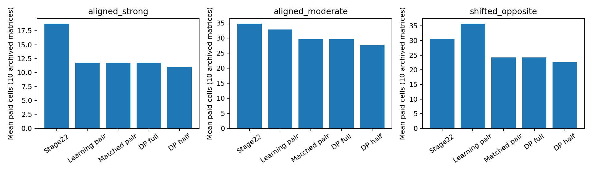
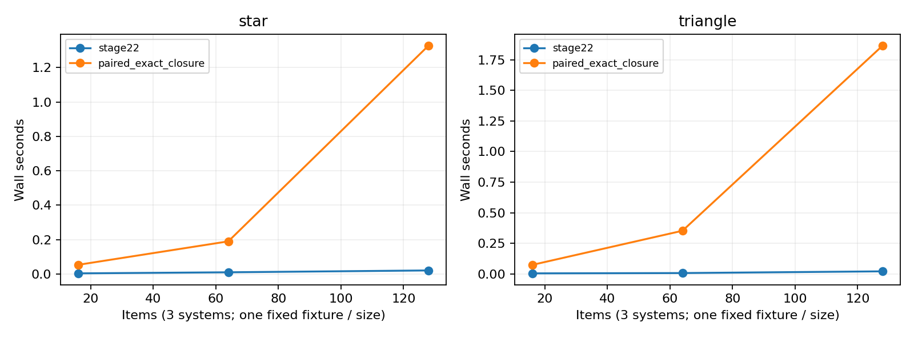

# Evaluation method screening before acceleration

**Decision: NO-GO for launching an acceleration research project around the
current expensive joint-order or sequential-DP variants.** There are competitive
exact methods, but their observed annotation efficiency does not require the
expensive implementations. The remaining partial-cell benefit is inconclusive.
Retain exact paired-difference methods as strong baselines; do not equate a slow
prototype with a valuable acceleration contribution.

Branch `research/method-screening-before-acceleration`, parent `a9c2f50`.
Only this directory is added. Main, previous experiments and their results are
unchanged. No WMT dataset is read; no candidate optimizer or acceleration is
implemented. New code consists of result audits, timing wrappers and comparison
adapters using existing paired-factor solvers. These adapters are screening
controls, not production replacements or claims of a new method.

## Comparability and statistical validity

There is no universal cross-stage leaderboard. The primary matched cohort is
three fixed binary system rows, 16 items, requested reference-star or triangle
signs, unique paid system-item cells, and taskwise 95% anytime familywise
correctness. Stars and triangles are separate tasks, each with its own alpha=.05.
We reuse all 100 archived matrices, including correlated scores, wrong predictions
and near ties. Comparison intervals are descriptive post-result bootstraps on
these fixed development scenarios, not independent validation or simultaneous
significance claims. Wrong completed paths retain their archived full-budget
charge; no low-cost error or unfinished run is rewarded.

The secondary cohort is two fixed binary systems, 32 items, the full-pool
difference sign, the same 95% anytime directional family guarantee and cell cost.
Every new full-block comparison uses an outcome-independent complete uniform
item path and purchases both endpoints before updating. Partial DP retains its
original justified adaptive purchases. The methods may have different sampling
designs, but have the same target, available prior information, cost and guarantee.
The strongest two-system control additionally matches both directional alternative
laws exactly. It changes only predictive-law assignments in an in-memory adapter
of the existing paired solver; the historical source and optimizer are untouched.

For a directional paired test, the actual remaining difference histogram is one
of the solver's feasible integer null completions. The selected factor is fixed
before the next uniform draw and its expectation is at most one under that null.
Predictive misspecification changes power, not this feasibility argument. Products
are nonnegative supermartingales. Threshold 2|E|/.05 plus a union bound, or the
archived nonvacuous order-closure rule, gives the taskwise family guarantee.
Logical remaining-total conclusions are exact. The new two-system adapter uses
two directions at threshold 40; see SUPPLEMENT_PROTOCOL.md. Floating-point
feasibility safeguards are retained; tiny exhaustive audits supplement the
conditional proof and do not themselves prove coverage.

Five-way panel preference inference on fresh inputs is a different estimand,
sampling model and cost unit. Stage 31 is assessed only against its own panel
control. Individual mean-precision SVD/trust/CS diagnostics cannot be ranked
against sign-certification methods. Stage 28--30 prospective repeated-rating
costs likewise cannot be pooled with unique fixed-cell caches. Zero-error logical
lookahead is compared only with its own same-certificate controls.

## Method screening across all five criteria

| Method / family | Validity and annotation evidence | Robustness | Computation / scalability | Decision |
|---|---|---|---|---|
| Stage 22 pruning | Existing fixed-pool taskwise guarantee; strong non-predictive requested-graph control | No predictive-law dependence; sparse graphs matter; not a human-rater drift guarantee | Prior profiling: subsecond replay in tested 5--30-system cases; offline path computation separate | Retain baseline; no demonstrated human-latency acceleration need |
| Prediction-aware paired exact closure / Bonferroni | Same requested-sign target and 95% family guarantee; competitive matched label costs below | Correlation allowed; predictions affect power; closure has a small reversed-star regression | Three-event histogram solver; 3-system implementation; tested through N=128; constraints grow quadratically in remaining items | Best baseline to retain; no current research GO for accelerating it |
| Joint-order calibration | Existing conditional joint-null guarantee; 197/200 costs equal to rebalanced pair control | Reversed histories can lose; one-step log-growth gains need not affect hard alternatives | Multiple constrained fits / order states; fixed 3-system code | NO-GO: unique label gain disappears against matched strong control |
| Pair-factor rebalancing | Same cell path and guarantee; essentially matches joint candidate | Same fixed-fixture robustness limitations | Current code calls state_update, which also computes joint factors; it is NOT an independently cheap implementation | Required statistical baseline; no claim of measured computational superiority |
| Two-system full-block sequential DP | Valid conditional factors; competitive versus Stage 22 | Both directional predictive alternatives must be matched | Prior profile identifies expensive DP separation; full-block costs match the simpler paired control in all 30 cases | NO-GO: costly representation not necessary for observed label efficiency |
| Two-system partial DP / adaptive q | Valid under original predictable purchases; partial q=.5 has only small uncertain gain over strong full control; adaptive q failed its gate | Adaptive q costs 22.29% more than fixed q=.5 in archived moderate scenario | DP plus repeated fitting; only two homogeneous binary rows | NO-GO now; establish reproducible incremental annotation benefit first |
| Stage 24 joint finite-pool prototype | Archived conditional coverage proof; covariance arm costs 11.42% more than Stage 22 | No aggregate covariance advantage; whole-row acquisitions limit pruning | Full grid inversion; no scalable continuous-score implementation | NO-GO for this candidate |
| Stage 25 adaptive partial-cell prototype | Archived 95% joint guarantee; benefit over Stage 22 ties matched joint controls | Extreme complete graphs can cost 14.29% more; exact ties exhaust pool | Binary grid exponential in systems; continuous tractable solver absent | NO-GO: no distinct statistical-efficiency benefit established |
| Shared-cell lookahead | Zero-error completion certificate; failed aligned 10% gain gate versus own greedy control | Outcome-model weighted expectations are design-specific | Exhaustive tiny-state diagnostic | NO-GO: expensive planning lacks sufficient matched benefit |
| Stage 31 adaptive panels | Valid under stated fresh-input preference model; 32.96% fewer panel tasks versus uniform in original development screen | Context/rater dependence outside stated model; no measured human time | Prior profiling: microsecond selection; C(S,5) initialization issue | No acceleration GO; stronger statistical baselines / real pilot needed |
| SVD / Adaptive Trust / predictor-CS diagnostics | Separate mean-precision protocol; oracle rows are unattainable diagnostics | Attainable prediction quality and history shift matter | Sparse candidate updates are existing engineering; no matched expensive sign-inference gain shown | Outside this acceleration shortlist; no cross-task ranking |

Stage 24/25 statements refer to `research/stage24-joint-finite-pool` and
`research/stage25-adaptive-partial-cells`, not the separately named exposure-audit
branches. They reuse archived assessments rather than new theorem verification.

## Reconstructed matched three-system results

Mean charged cells, 20 matrices per scenario, 48 available cells. These are
the same input matrices, requested signs, alpha and prior information; pair
rebalancing shares the joint candidate's exact cell stream. Common-item controls
share the same precommitted item order but use their own valid retirement rules.

| Scenario | Graph | Stage 22 | Exact paired closure | Rebalanced pairs | Joint |
|---|---|---:|---:|---:|---:|
| Independent strong | Star | 33.50 | 29.55 | 29.65 | 29.65 |
| Independent strong | Triangle | 38.65 | 36.45 | 35.05 | 35.05 |
| Independent moderate | Star | 41.10 | 40.00 | 39.10 | 39.30 |
| Independent moderate | Triangle | 43.55 | 43.40 | 41.65 | 41.60 |
| Correlated strong | Star | 34.25 | 29.40 | 28.40 | 28.40 |
| Correlated strong | Triangle | 38.70 | 34.90 | 34.90 | 34.90 |
| Reversed predictions | Star | 34.65 | 35.55 | 37.85 | 37.90 |
| Reversed predictions | Triangle | 39.70 | 39.45 | 41.40 | 41.40 |
| Near ties | Star | 44.00 | 43.70 | 44.90 | 44.90 |
| Near ties | Triangle | 45.75 | 45.50 | 45.80 | 45.80 |

Thus expensive joint calibration is not a new statistical-efficiency winner.
Exact paired closure is competitive, but not uniformly optimal: reversed-star
cost is 2.60% above Stage 22. No oracle choice of the best method per scenario is
reported as an implementable policy. `matched_archive.csv` reconstructs all 50
method/stratum means; `paired_archive.csv` contains matched contrasts and intervals.

## Necessary two-system strong-control diagnostic

The old sequential archive attaches an index-sorted remainder after its stopped
random full-block prefix. Uniform-without-replacement validity of the resulting
Stage 22 tail is not established. This is a control-design limitation, not a proof
of empirical undercoverage or an invalidity finding for the DP. We preserve the
old column, regenerate a full outcome-independent uniform path, and verify that
all 30 archived full-DP prefixes match it exactly. Stage 22 costs change in
18/30 cases. Use the new uniform-path comparator for this screen.

Mean cells over ten existing matrices per scenario:

| Scenario | Uniform-path Stage 22 | Existing learning paired control | Matched directional-law paired control | Full DP | Partial DP q=.5 |
|---|---:|---:|---:|---:|---:|
| Strong | 18.8 | 11.8 | 11.8 | 11.8 | 11.0 |
| Moderate | 34.8 | 32.8 | 29.6 | 29.6 | 27.6 |
| Reversed | 30.6 | 35.8 | 24.2 | 24.2 | 22.7 |

The learning paired control and DP use different predictive policies. In
particular DP uses Design(pa,pb) for the positive direction and
Design(1-pa,1-pb) for the negative. The fixed-law control matches both laws,
using (1-pb,1-pa) for the negative B-A difference. An initial diagnostic that
failed to match that negative law is retained in the explicitly excluded
`fixed_law_initial_direction_mismatch.json`. It is not used as final evidence.
The follow-up was a post-result mechanism diagnostic, not independent validation
or outcome-tuned selection among many priors.

**All 30 full-DP costs match the matched-law paired baseline, case by case.**
Partial DP saves 6.78%, 6.76%, 6.20% relative to that baseline. Descriptive paired
95% ratio-of-mean intervals are respectively [-5.36%,17.21%], [-16.00%,23.20%]
and [-32.94%,36.18%]. All include zero. The archive's original incremental
partial-method gate also failed. This does not prove partial inference can never
help; it does not yet justify an acceleration research project.

For full paired purchases with homogeneous predictions, remaining completions
can assign every zero difference to either 00 or 11. The worst-null constraint
therefore uses max(f00,f11). Raising the smaller zero factor to the larger one
preserves feasibility and weakly increases predicted log growth. A three-event
difference factor is sufficient for an optimum of that restricted representation
(with common factor bounds). This elementary reduction explains why expensive
full-block DP need not provide a label advantage. It is not a new theorem for
partial caches, heterogeneous item predictions, joint orders or numerical solver
equivalence. Existing implementations retain their different original factor
bounds (DP upper bound 100; paired 10000); empirical equality is established
only on the recorded cases.

## Computational value of the surviving control

Only the competitive paired-control bottleneck needs a new scaling check.
Fresh-process, cold-cache medians of three runs on one fixed strong fixture
per size (not a new efficacy sample):

| N | Graph | Paired closure wall | CPU seconds | Process peak MiB | Cells bought | Inference fraction |
|---:|---|---:|---:|---:|---:|---:|
| 16 | Star | 0.054 s | 0.0156 | 67.3 | 26 | 53.1% |
| 16 | Triangle | 0.075 s | 0.0000 | 67.4 | 39 | 53.6% |
| 64 | Star | 0.190 s | 0.0625 | 68.9 | 45 | 77.4% |
| 64 | Triangle | 0.353 s | 0.1406 | 69.6 | 74 | 79.8% |
| 128 | Star | 1.328 s | 0.4531 | 75.1 | 93 | 91.5% |
| 128 | Triangle | 1.866 s | 0.8906 | 77.8 | 110 | 93.5% |

Runtime grows and inference dominates at N=128; this is a real scaling concern,
not a demonstrated current human-latency bottleneck. At 30 s/cell, computation
is only 0.0565% of serial triangle time at N=128, or 0.169% at 10 s/cell.
The optimistic 100-worker aggregate model raises the 30-second share to 5.35%.
That is potential future engineering value; a single adaptive trajectory cannot
simply dispatch 100 dependent future queries. Larger pools/system counts and
actual intended concurrency are unmeasured.

All 84 new timing runs complete; 60 archived runs reproduce saved costs and
decisions. The 24 additional timings use two bounded scale fixtures, not large
WMT workloads. Process peaks include imported joint-control machinery and setup;
they are not algorithm-only allocations. Windows CPU-clock quantization explains
zero CPU readings for short cases. Timed paired_update calls are included in
wall time and do not isolate all inference: other includes order closure and
bookkeeping. Stage 22 timing includes offline full-path evidence and footprint
pricing, not a deployable online CS implementation.

Six once-per-fixture DP replays reproduce archived paths and all outputs. On
repeat=0 in the three scenarios, full-DP wall is 1.131/4.744/2.692 s versus
0.032/0.041/0.030 s for the matched-law paired control; these are descriptive
single-run timings with different numerical implementations, not a general
speedup theorem. Crucially, their paid costs match. Prior profiling's two-system
DP attribution must not be transferred to the different histogram solver.

## Theoretical novelty, limitations and next step

Growth-optimal e-values and optional-continuation validity are established in
[Safe Testing](https://arxiv.org/abs/1906.07801). Finite-pool time-uniform
inference predates this project: [Waudby-Smith and Ramdas, NeurIPS 2020](https://proceedings.neurips.cc/paper/2020/hash/e96c7de8f6390b1e6c71556e4e0a4959-Abstract.html).
Caching, faster generic optimization, or the elementary three-event reduction
does not establish a distinct theoretical contribution. [Active Evaluation](https://aclanthology.org/2022.acl-long.600/)
studies top-system identification with dueling comparisons; its headline savings
are not imported into our fixed-pool all-requested-sign familywise comparison.
This focused primary-source check is not an exhaustive novelty review.

The most promising retained baseline is exact paired-difference inference, but
there is no established nontrivial acceleration theorem or sufficient deployment
need at measured scales. The genuine open statistical question is whether partial
or joint inference produces a reproducible incremental label benefit against
matched predictive paired factors and rebalanced evidence. That question should
be resolved before paying for a major acceleration study.

**NO-GO now:** do not accelerate the current expensive variants as the next main
research project. Keep the existing paired controls, settle robust statistical
advantage on separately frozen problems, and measure actual human/UI latency and
concurrency. Reopen computational research only if a competitive method still
has a demonstrated limiting regime after these controls, and a plausible new
complexity/certification result beyond engineering. This is not a theorem that
all expensive methods are ineffective or that larger-scale acceleration is useless.

Historical priors are supplied without charging their training labels. Human
timings are sensitivity assumptions, not collected observations. All fixtures
are small binary development problems; no multi-system continuous-score or
human-rater guarantee, WMT generalization, or ICML readiness is established.
