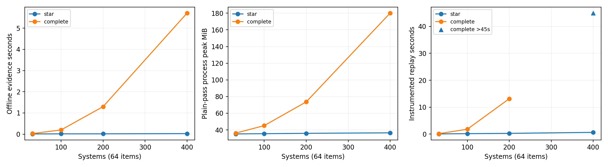
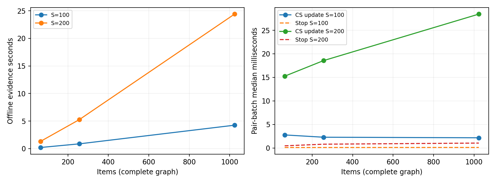

# Scalability audit: anytime-valid pairwise MT evaluation

**Research decision: NO-GO for a new computational-CS research claim on current
evidence. Engineering decision: GO for addressing the existing dense replay's
scalability, if large offline studies are needed.** Efficient scalar CS primitives
already exist; this implementation's repeated graph scans and full-trajectory
storage are avoidable. It would be incorrect either to call the whole current
pipeline efficient at hundreds of systems, or to call those avoidable costs a
new statistical research opportunity.

Branch `research/anytime-pairwise-scalability-audit`, parent `5d991e7`. Only this
experiment directory is added. Main and all previous code/results are unchanged.
Synthetic bounded scores only; no WMT dataset is accessed. No optimization,
streaming runner, dependency index or alternative CS is implemented.

## What is measured

The audited scalable implementation is the existing Stage17 continuous finite-pool
pair evidence, with Stage22 requested-graph pruning/replay. Both use the original
six betting components, alpha=.05 per fixed requested graph, first decisions,
common uniform item permutation and label priorities. Arrays and decisions are
unchanged. The CS-update kernel is a **fixed-null sign e-process**, not inversion
of a confidence interval over many candidate means. This distinction matters:
the audit cannot establish the computational cost of arbitrary CS interval or
exact rank-set inversion.

The frozen matrix includes 32/100/200/400 systems, 64/256/1024 items, stars,
complete graphs and a ring diagnostic. A 200-system exact-tie stress case is
included. Complete 400x1024 is excluded before execution by the declared memory
estimate (3.65 GiB against a 1.5-GiB preflight threshold), not counted as a failed
or successful measurement. The largest tested graph has 79,800 requested pairs.
The prior exact DP/grid implementations do not support general hundreds-system
inference and are not silently generalized to create a comparison.

Plain evidence time includes input validation, dense pair difference construction,
all N wealth updates, crossings and complete event/evidence histories. Phase
attribution is a separate instrumented pass requiring exact array equality. Its
update/stop quantiles are for all P pairs at one common item, not one queried cell.
Replay runs once per case with timing instrumentation and a 45-second cutoff;
evidence has three fresh-process repetitions. Complete timing ranges and all
censored attempts are retained. These are one-machine timing repetitions, not
dataset or annotation-efficiency uncertainty intervals.

Stage22 replay consumes future-score paths precomputed by the offline simulator.
The future labels are simulation inputs, not authorized observations of an online
evaluator. Its close_free time is prefix availability/resolution, not CS arithmetic.
No streaming production performance is inferred from this replay.

## Benchmark results

Twenty cases, 60 main evidence attempts: 59 completed, all with bitwise event
and evidence-array parity. Fifteen main replays completed and four were censored
at 45 seconds. One worker hit its 180-second limit before any checkpoint; that
case has two completed timing repetitions. One separately recorded same-input
diagnostic completed and is excluded from main medians. Seven unchanged synthetic
Stage22 tests pass; both smallest-fixture replay ledgers/decisions also match
the original function. These checks establish preservation, not a new coverage
theorem. Full verification is in results/verification.json.

Representative measured values (complete graphs unless marked star):

| Systems | Items | Pairs | Plain evidence median (s) | CS update p50 / p95 (ms) | Crossing checks p50 (ms) | Replay (s) | Plain process peak (MiB) |
|---:|---:|---:|---:|---:|---:|---:|---:|
| 32 | 64 | 496 | 0.029 | 0.30 / 0.58 | 0.026 | 0.137 | 36.2 |
| 100 | 64 | 4,950 | 0.202 | 2.77 / 3.78 | 0.103 | 1.788 | 45.2 |
| 200 | 64 | 19,900 | 1.301 | 15.25 / 22.88 | 0.461 | 13.148 | 73.7 |
| 400 | 64 | 79,800 | 5.714 | 69.57 / 90.54 | 2.339 | >45 | 180.2 |
| 100 | 256 | 4,950 | 0.864 | 2.29 / 3.70 | 0.106 | 4.202 | 70.0 |
| 200 | 256 | 19,900 | 5.254 | 18.56 / 40.71 | 0.806 | 41.419 | 174.3 |
| 400 | 256 | 79,800 | 19.709 | 62.50 / 82.12 | 2.300 | >45 | 589.8 |
| 100 | 1,024 | 4,950 | 4.250* | 2.17 / 4.07 | 0.116 | unavailable* | 172.9 |
| 200 | 1,024 | 19,900 | 24.406 | 28.44 / 45.06 | 1.044 | >45 | 585.1 |
| 400, star | 256 | 399 | 0.085 | 0.24 / 0.45 | 0.025 | 1.397 | 39.4 |

Update/check phase quantiles are medians across repetitions of instrumented
per-item pair-batch quantiles; plain evidence and phase timings are different
passes. Replay is a single instrumented observation per case, not a median.
Stars and complete graphs ask different sets of questions; their runtime
contrast is structural scaling evidence, not an annotation-efficiency comparison.

For completed first attempts, plain evidence plus instrumented replay totals
0.163 s (32x64), 1.990 s (100x64), 14.441 s (200x64), and 45.801 s (200x256).
These sums exclude the extra attribution pass and imports/fixture setup; they
are not end-to-end production service timings. Censored first-attempt totals
exceed 50.714 s (400x64) and 85.211 s (400x256). See same-attempt total fields
in summary.csv; do not add a median from one run to a timeout from another.

At 200x256, the replay buys 51,094 cells. close_free consumes 39.112 of 41.419
seconds (**94.43%**); global stopping predicates consume 0.825 s (**1.99%**).
CS arithmetic is already done offline and is not hidden inside close_free.
The dense bottleneck is primarily availability scanning, not just checking
whether all pairs have finished. At exact ties, 200x256 complete replay also
exceeds 45 s; no partial label count is reported as a completed result.

Plain high-water memory grows from 36.2 MiB at 32x64 to 589.8 MiB at 400x256.
The attribution pass retaining both output sets reaches a median 765.5 MiB for
the latter case. These include interpreter/imports/fixtures/temporaries. A
timed-out replay may have a larger unobserved peak than its last checkpoint.
For comparison, the mathematical 400-system pair capital/sum arrays alone need
112P bytes = 8.52 MiB; that is a state-size calculation, not measured optimized
memory or a promise that the entire evaluator can fit in that space.

*The 100x1024 complete worker anomaly is preserved. Its two completed evidence
runs took 5.093 and 3.406 s. A diagnostic retry took 4.552 s evidence and 27.831 s
replay (87,899 labels), with parity; it does not establish the stall's root cause
and is excluded from medians. Other large timing ranges are substantial too:
400x256 evidence is 19.640--40.211 s; 200x1024 is 11.102--34.001 s. Do not use
small timing differences or three points to infer precise complexity exponents.

## Bottlenecks and complexity

Let S be systems, P requested pairs, N items, K=6 components, L paid labels and
Q consumed pair-prefix observations through each pair's first decision.

| Component | Current time | Current space / qualification |
|---|---|---|
| Wealth recurrence and mixture | Theta(PNK) over the full path | O(PK) mathematical state |
| Full event/evidence history and dense pair differences | Theta(PN) output/work | Theta(PN) retained/transient arrays |
| Repeated permutation validation | O(PN log N) sorting | Dense P-by-N permutation and sorted copy |
| Global unresolved checks, decision copies and resolution scans | Theta(LP) | P-sized temporaries |
| close_free availability scans | At least full P scan per acquired label; repeated closure can add work | P-sized active/frontier arrays |
| Active-system priority sorting | At most O(NS log S) across item blocks | Active systems / label ledger |
| Diagnostic snapshots | O(PN) per fixed checkpoint | Dense endpoint-score gathers |

For a complete graph P=Theta(S^2) and census-like L=Theta(SN), repeated scans
introduce cubic-in-S replay work, beyond the quadratic pair-update work. Ties
and close gaps are important because they keep many edges unresolved. Increasing
S in our separated fixtures also shrinks adjacent gaps; total runtime therefore
combines arithmetic scaling with a longer unresolved trajectory. No exponent
is fitted from these few data points.

## Can complexity improve without losing validity or labels?

Yes, in a restricted, familiar engineering sense. [COMPLEXITY.md](COMPLEXITY.md)
gives three exact-recurrence arguments:

1. A counter of absorbing unresolved edges reproduces every global completion
   predicate, replacing Theta(LP) stopping scans with O(P+L) total work.
2. Reverse indexing of missing endpoint cells makes prefix closure an
   output-sensitive dependency problem: O(P+L+Q) bookkeeping rather than scanning
   every pair after each label. Its unique monotone fixed point equals the
   original exhaustive closure. Keeping original priority selection then keeps
   every acquired label, first decision and stopping label count unchanged.
3. The same pair recurrence can retain current sums/capitals instead of full
   histories. O(SN+PK+P+N) state including original seen/priority tables suffices
   if full trajectory output is not required; original betting arithmetic adds
   O(KQ) work through first resolutions.

These are paper analyses, not implemented or measured speedups. Equivalence
transfers the original statistical guarantee pathwise under the same sampling
and support assumptions. Floating-point implementations would still require
parity/rounding checks. They do not justify reading future labels, skipping
unresolved evidence, changing alpha, or changing the requested comparisons.
Counters alone do not solve the dominant availability scans.

There are real limits: returning all PN trajectory values has Omega(PN) output
size, and explicitly emitting P statuses costs Omega(P) per report. Neither
proves a universal Omega(P) inference lower bound for compressed algorithms.
We establish no lower bound ruling out every useful subquadratic method.

## Existing methods: solved versus unresolved

[Predictable plug-in and betting CSs](https://arxiv.org/html/2010.09686v6) and
[time-uniform mixture boundaries](https://arxiv.org/abs/1810.08240) already provide
efficient scalar tools. The original fixed-mixture kernel is itself constant
work per pair observation for fixed K. Its PN offline arrays are not a
statistical requirement. A different boundary or per-system CS may be valid
but may stop later; shared-item covariance can matter, so equal nominal coverage
alone does not establish equal annotation efficiency.

[Rank Confidence Sequences](https://arxiv.org/html/2609.32211v1) supplies exact
and conservative shortcut certifiers and a coNP-hardness result for its general
exact ordering-certification problem. That problem is different from Stage22's
independent requested-edge decisions. Its shortcut can certify less, so it is
not a proved no-label-loss replacement. [AnyRank](https://arxiv.org/html/2610.14603v1)
already studies adaptive ranking and retirement, but its sample-complexity
experiments and i.i.d. rollout setting do not establish CPU scalability on this
400-system finite-pool task. See [RELATED_WORK.md](RELATED_WORK.md).

## Practical interpretation and recommendation

Large dense offline replays are a meaningful computational bottleneck: repeated
Monte Carlo studies can multiply these costs. This updates the small-scale
profiling conclusion's scope; it does not refute the fast scalar-CS result.
For human annotation, serial per-label latency is much larger than the measured
per-label replay costs. High concurrency and automatic score acquisition can
change the operational tradeoff. No new human annotation times were measured.
For the completed 200x256 example, replay averages 0.811 ms per label. At an
assumed 30 seconds/label, evidence plus replay is approximately 0.003% of serial
annotation-plus-computation time. This is a sensitivity calculation, not an
observed human timing result or a bound for censored cases.

**NO-GO for an ICML-style acceleration claim now.** The demonstrated waste has
standard streaming/incremental remedies. Existing related work already contains
efficient CSs, retirement and closure shortcuts. The hard general exact-closure
question is recognized prior art, not a newly discovered SAFE-EVAL bottleneck.
No current result establishes a novel computational theorem with a competitive
statistical advantage beyond these tools.

**GO only for scoped engineering if needed:** preserve the exact evidence,
requested graph and acquisition ledger, remove redundant scans/history storage,
then validate parity and measure actual speed/memory. This audit deliberately
does not implement that work. Reopen research only after an effective matched
method still has a limiting regime beyond those elementary remedies, together
with a nontrivial complexity/power tradeoff or structure-exploiting theorem.

No conclusion covers all SAFE-EVAL variants, full continuous-score joint inference,
general adaptive nonuniform sampling, predictor fitting or production serving.
The source machine is not isolated; ranges, censoring and the anomalous worker
diagnostic must accompany any quoted point timings. The suggested engineering
improvements preserve this specific decision rule, not arbitrary closed testing.
