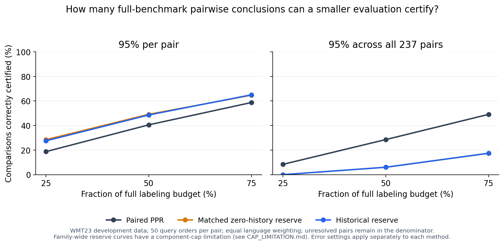

# Stage 13 findings: smaller evaluations preserve some pairwise conclusions

**Feasibility is supported on this fixed development benchmark; added value from history is not established.** A standard paired sequential baseline uses 68.8614% of the full labeling budget on average with a nominal 95% guarantee across all 237 pairwise claims. No wrong PPR decision was observed in 11,850 query-order trials. Near-tied pairs still need almost all labels.

The historical reserve has small, mixed per-pair effects. Its family-wide costs also have an avoidable [component-cap limitation](CAP_LIMITATION.md); those costs cannot establish that history itself is inefficient. No novelty or minimum-test-set theorem is claimed.

## What was measured

Every unordered system pair on the unchanged WMT23 binary recorded error-free matrices was included: 66 en-de, 66 he-en and 105 zh-en pairs; 50 uniform query permutations each. Both target systems were excluded from historical input. The reference conclusion is the sign of the complete fixed-pool difference in error-free proportions. There are no exact ties in these 237 pairs. This is not official MQM, a population significance comparison, or a universal shared reduced test set.

Each paired query reveals two system-item annotations. Budget fractions below are means of the per-pair fractions, averaged equally over languages and then pairs. They are not the ratio of all pooled label counts. Cost includes every first decision, including wrong decisions; unresolved comparisons remain in budget diagnostics.

## Main results

### 95% per pair

| Method | Mean full-budget fraction | Correctly decided by 75% budget | Wrong decisions / 11,850 |
|---|---:|---:|---:|
| Deterministic certificate | 91.6543% | 0.0000% | 0 |
| Paired PPR | 60.1405% | 58.7483% | 0 |
| Matched zero-history reserve | 53.8939% | 64.7076% | 3 |
| Aligned-history reserve | 54.1763% | 65.0387% | 2 |
| Permuted-history reserve | 54.1272% | 65.1466% | 3 |
| Reversed-history reserve | 54.1412% | 65.0785% | 2 |

### 95% across all 237 pairs, separately for each fixed method

| Method | Mean full-budget fraction | Correctly decided by 75% budget | Wrong decisions / 11,850 |
|---|---:|---:|---:|
| Deterministic certificate | 91.6543% | 0.0000% | 0 |
| Paired PPR | 68.8614% | 49.0782% | 0 |
| Matched zero-history reserve | 86.3085% | 17.3922% | 0 |
| Aligned-history reserve | 86.2902% | 17.4101% | 0 |
| Permuted-history reserve | 86.3161% | 17.3036% | 0 |
| Reversed-history reserve | 86.2934% | 17.3506% | 0 |

The family-wide reserve rows retain the frozen cap interaction documented above. A per-pair guarantee does not license an unadjusted claim about all pairs. Zero observed errors in 50 family repetitions does not empirically establish a universal error rate; the nominal bound comes from the design calculation and union bound. Multiple displayed methods do not share one joint 95% guarantee.

## How small can the paired-PPR evaluation be?

| Budget | Correct decisions, per-pair setting | Correct decisions, family setting |
|---|---:|---:|
| 25% | 18.7449% | 8.4000% |
| 50% | 40.5429% | 28.5570% |
| 75% | 58.7483% | 49.0782% |

In the family setting, PPR uses 82.3274% of full labels for en-de, 55.9557% for he-en and 68.3010% for zh-en. The equal-language average is 68.8614%, with conditional Monte Carlo SE 0.0628 percentage points. These repeats measure random-order variation on the fixed data, not generalization uncertainty.

| Absolute complete-benchmark gap | Pairs | Mean full-budget fraction, family PPR |
|---|---:|---:|
| Greater than 0, at most 0.02 | 29 | 98.9702% |
| Greater than 0.02, at most 0.05 | 52 | 93.1551% |
| Greater than 0.05 | 156 | 55.4786% |

These strata are descriptive only; complete labels never select the query order or method. A fixed tiny evaluation cannot be assumed sufficient for close comparisons. A practical-equivalence margin would be a new estimand and requires a new protocol.

## Does historical assistance add value?

At per-pair 95%, aligned history reduces equal-language mean paired queries by 1.221547 versus matched zero (conditional MCSE 0.309689), a 0.484434% reduction in that absolute-cost statistic. It wins on 92 pair means, ties on 7 and loses on 138. German cost increases 2.532874%; Hebrew decreases 1.205459%; Chinese decreases 0.689438%. The largest paired-path overhead is 727 queries (1,454 target labels).

On normalized budget fractions, aligned history is worse: 54.1763% versus 53.8939% for matched zero. The opposite signs of these two summaries follow from different pool sizes; both are reported. Reversed history gives a similar absolute-cost change (-0.486180%), and permuted history also improves the absolute-cost statistic (-0.317432%). This does not establish a reliable benefit from correctly aligned historical information.

The standalone paired-PPR method uses 60.1405% of full budget in the per-pair setting, versus 54.1763% for the historical reserve. Much of that improvement is already obtained by the zero-history reserve (53.8939%). The reserve architecture and betting choice explain substantial gains without history. Family-wide reserve comparisons are further limited by the cap interaction.

## Verified scope and limits

- All 142,200 saved first decisions and 6,306,450 paired query steps passed replay.
- The independent raw optimizer checked 9,888,736 distinct-within-time directional count states.
- All 403,612,800 expert updates were reconstructed with Python big integers; historical pre-query states were independently replayed.
- 67 invariant tests passed. Additional validation enumerated 23,112 complete item orders for 80 small fixed pools and checked 277,344 method/error-setting decisions.
- Six damaged local archives were regenerated with unchanged code/seeds; every recovered archive matches the original recorded SHA256 byte for byte. The original run metadata was preserved.
- WMT23 remains development data. Pairs share systems and items; random query orders are not independent new benchmarks. Historical annotation cost, rater uncertainty and future-document uncertainty are absent.

## What to discuss with Professor Koehn

The existing paired baseline makes the goal concrete: fewer labels can certify a useful subset of complete-benchmark conclusions, while close comparisons remain expensive. The unresolved contribution is added efficiency beyond strong existing inference, under an MT-relevant definition of a finding.

Ask whether the main target should be severity-weighted MQM superiority, practical equivalence, or a reusable reduced test set across systems. A bounded technical follow-up is to correct the family reserve cap before treating that extension as an efficiency comparator. Neither that correction nor the previously proposed predictor-component ablation has been run.

## Sources and reproducibility

Run commands and scope: [README](README.md). Frozen plan: [PROTOCOL](PROTOCOL.md). Calculations: [THEORY](THEORY.md). All method/pair/budget results, compact decisions and audit hashes are in [results_reference](results_reference).

- Waudby-Smith and Ramdas (2020): https://proceedings.neurips.cc/paper/2020/file/e96c7de8f6390b1e6c71556e4e0a4959-Paper.pdf
- Gao, Sicilia and Shi (2026): https://arxiv.org/html/2608.26638
- Lo and Knowles (2023): https://aclanthology.org/2023.findings-acl.826/

These results are an application and diagnostic study of existing principles; the Stage 12 novelty audit remains applicable.
